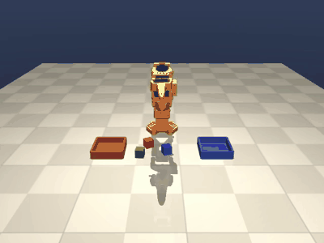

# SO-101 Workcell

Language-driven pick-and-place for the [SO-101](https://github.com/TheRobotStudio/SO-ARM100) desk arm,
built and tested entirely in MuJoCo on a laptop (RTX 3050 6 GB, 12 CPU threads), with the same
joint-command stream targeting a Cyberwave digital twin or the real arm.

<p align="center">
  
</p>

> "red and blue go to the left bin, green to the right bin" -> perception -> plan -> verified skills.

## What is here

| Layer | Folder | What it does | Status |
|---|---|---|---|
| Simulation | `so101_workcell/sim` | Official SO-101 MJCF + fingertip pads, tabletop scene with cubes and bins, damped-least-squares IK, straight-line Cartesian moves, scripted pick/place skills that **verify** every step from simulator state | 90/90 pick-and-place on random layouts |
| Agent | `so101_workcell/agent` | Overhead-camera colour detector (2 mm localisation), rule-based planner, Claude vision-language planner with a JSON-schema plan, executor with retries | end-to-end instruction following |
| RL | `so101_workcell/rl` | Gymnasium grasp-and-lift env with domain randomisation (mass, size, friction, servo gain, gravity, control latency, noise), SAC training and evaluation | see Results |
| Backends | `so101_workcell/sim/backends.py` | Same 10 Hz joint-target stream to local MuJoCo, a Cyberwave twin (playground / cloud MuJoCo / live arm), or a dry-run logger | replay test passes |
| Hub | `so101_workcell/hub` | LeRobot v3 dataset export of scripted demos, Hugging Face model/dataset upload with generated cards | export verified |

The design principle is **the model decides *what*, code decides *how***: the planner only names
objects and bins; the skills own the geometry, close the loop on simulator state, and retry.

## Results

### Scripted skills (`scripts/eval_scripted.py`)

| layouts | attempts | success |
|---|---|---|
| 30 random (3 cubes each, random yaw) | 90 | **90 (100%)** |

Failure modes fixed along the way are documented in [docs/design.md](docs/design.md).

### Reinforcement learning (`scripts/train_rl.py`, SAC, 200k steps, 4 envs)

_Training in progress on the laptop GPU; numbers land here when the run finishes._

| condition | episodes | lift success | grasp rate |
|---|---|---|---|
| nominal physics | 50 | TBD | TBD |
| domain-randomised | 50 | TBD | TBD |

A scripted oracle acting through the same 4-D action interface succeeds 8/10 nominal and 7/10
randomised episodes, which bounds what the policy should reach.

## Quick start

```bash
uv venv --python 3.11 .venv
uv pip install --python .venv/Scripts/python.exe torch --index-url https://download.pytorch.org/whl/cu128
uv pip install --python .venv/Scripts/python.exe -e ".[dev]"
.venv/Scripts/python.exe -m pytest -q            # 14 tests, ~20 s
```

```bash
# scripted demo with video
python scripts/demo_pick_place.py --seed 0 --video outputs/demo.mp4

# language-driven run (offline rule planner)
python scripts/run_agent.py --instruction "put the red cube in the left bin" --planner rule

# same with the Claude vision planner (needs ANTHROPIC_API_KEY; pip install -e ".[vlm]")
python scripts/run_agent.py --instruction "sort the cubes: red left, the rest right" --planner claude

# success-rate evaluation over random layouts
python scripts/eval_scripted.py --episodes 30

# RL: train, evaluate, render
python scripts/train_rl.py --steps 200000 --run lift_sac --n-envs 4
python scripts/eval_rl.py --model runs/lift_sac/final.zip --episodes 50 --video outputs/rl_lift.mp4

# stream a planned episode to a Cyberwave SO-101 twin (free Playground; needs CYBERWAVE_API_KEY)
python scripts/replay_to_cyberwave.py --backend playground

# LeRobot dataset of scripted demos (pip install -e ".[lerobot]"), optionally pushed to the Hub
python -m so101_workcell.hub.lerobot_export --episodes 50 --repo-id <user>/so101_sim_pick_place --push
```

## How it works

```
instruction ──► perception (overhead cam, colour blobs) ──► planner (rule | Claude VLM, JSON schema)
                                                                     │  [{pick_and_place, red, bin_left}, ...]
                                                                     ▼
                                   executor (retries) ──► skills: pick / place (IK + straight-line moves,
                                                                   clearance-ranked grasp direction,
                                                                   verified from sim state)
                                                                     │  10 Hz joint targets
                                                                     ▼
                                         MuJoCo  |  Cyberwave twin (playground / sim / live)  |  real SO-101
```

* **IK**: damped least squares on the fingertip site for position + finger direction, with the
  closing-axis sign honoured and the rest posture projected into the nullspace.
* **Grasp direction**: the four cube face normals are ranked by the clearance of the moving
  jaw's 9 cm closing arc from other cubes and bin walls (the single biggest reliability win).
* **Verification**: `pick` checks the cube is lifted, `place` checks it landed inside the bin;
  the executor retries up to three times before reporting failure.
* **RL env**: 4-D action (Cartesian delta + gripper), 23-D proprioceptive observation, dense
  reach/grasp/lift reward, 10 Hz, 100-step episodes.

## Hardware notes

Everything in this repository was developed on an RTX 3050 laptop GPU (6 GB) and a 12-thread CPU.
MuJoCo runs at ~85k physics steps/s per core here; the RL environment with IK runs at ~390
steps/s single-process. SAC training at 4 envs runs at ~75 env steps/s on this GPU. Isaac Sim is
not required anywhere.

## Credits

SO-101 model from [TheRobotStudio/SO-ARM100](https://github.com/TheRobotStudio/SO-ARM100)
(Apache-2.0). Built with MuJoCo, Gymnasium, Stable-Baselines3, LeRobot, the Cyberwave SDK, and the
Anthropic SDK.

## License

Apache-2.0.
